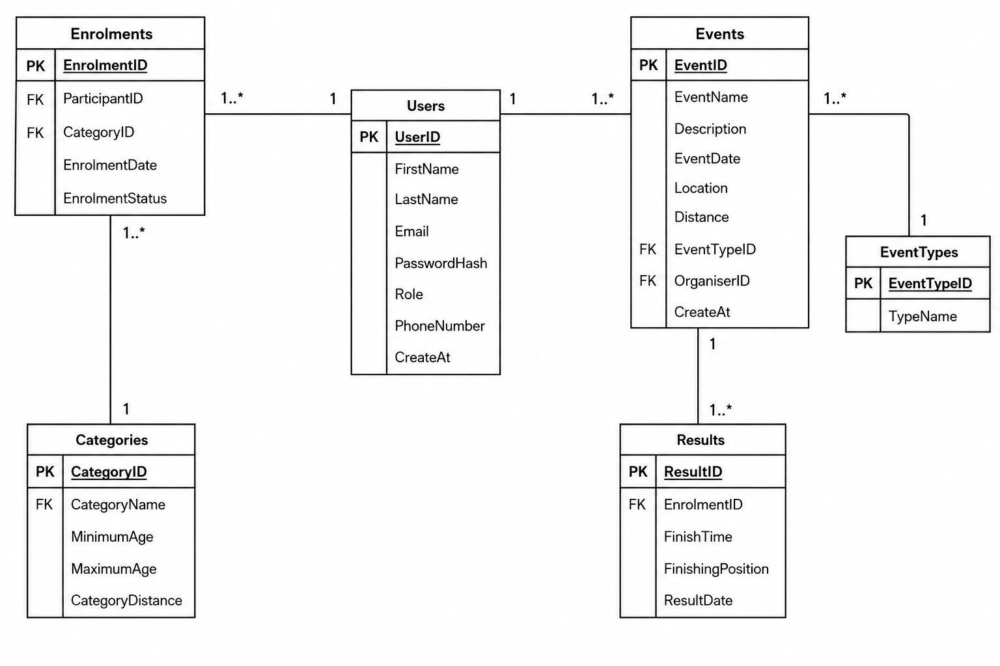

# RaceDay - Race Event Management System

RaceDay is a web-based event management platform for the South African road running, walking and cycling community. **Organisers** create and manage events, categories and results. **Participants** browse events, enter them by choosing a category, and view their own results.

This repository is the Portfolio of Evidence (POE) for PROG6212, submitted in three parts:

| Part | Content | Location |
|------|---------|----------|
| Part 1 | ERD, API endpoint plan, SQL script | [`/docs`](docs) |
| **Part 2 (this submission)** | **RESTful API (ASP.NET Core 8 + EF Core + SQL Server), Swagger, unit tests, CI/CD** | [`/Part2/RaceDay`](Part2/RaceDay) |
| Part 3 | MVC front end, Azure Blob Storage, Docker | _to follow_ |

## Video Presentation (Part 2)

**YouTube (unlisted):** https://youtu.be/Zo-stGnInX8

The video demonstrates the running API in Swagger, explains the code structure, endpoints, session authentication and role enforcement, and runs the unit tests.

---

## The Two Roles

| Role | Can do | Cannot do |
|------|--------|-----------|
| **Organiser** | Create, update and delete **their own** events; define categories for their events; view all enrolments for their events; capture and update finish times and finishing positions; view event results; view and update own profile | Enrol in events; view "my enrolments" / "my results" (Participant-only) |
| **Participant** | Browse events and categories; enrol in an event by choosing a category; view and cancel their own enrolments; view their own results; view and update own profile | Create, update or delete events/categories; view an event's enrolments; capture results |

Both roles must log in first. Anything outside a user's role returns **403 Forbidden**; no session returns **401 Unauthorized**.

> **Role selection at registration:** the user picks `Organiser` or `Participant` when registering, as required by the brief. The API validates that the value is one of the two allowed roles (and the database enforces it with a CHECK constraint). In a production system, Organiser accounts would normally need approval.

---

## Technology

- ASP.NET Core Web API (.NET 8), C#
- Entity Framework Core 8, **Code-First** with migrations
- SQL Server (SQL Express / LocalDB)
- BCrypt.Net-Next for password hashing
- Server-side sessions (`AddSession`) for authentication state
- Swashbuckle (Swagger UI) with XML documentation comments
- xUnit + `WebApplicationFactory` + EF Core InMemory for tests
- GitHub Actions for CI

---

## Repository Structure

```
RaceDay/
├── .github/workflows/ci.yml        # Build + test + structure validation
├── docs/                           # Part 1: ERD, endpoint plan, SQL script
├── Part2/RaceDay/
│   ├── RaceDay.slnx
│   ├── RaceDay.Api/
│   │   ├── Controllers/            # Auth, Profile, Events, Categories, Enrolments, Results
│   │   ├── DTOs/                   # Request/response models with validation
│   │   ├── Data/                   # RaceDayDbContext (relationships, constraints, seed data)
│   │   ├── Filters/                # SessionAuthorizeAttribute (role enforcement)
│   │   ├── Migrations/             # EF Core migrations
│   │   ├── Models/                 # Entities matching the Part 1 ERD
│   │   ├── Services/               # PasswordService, session helpers
│   │   └── Program.cs              # Sessions, Swagger, EF Core registration
│   └── RaceDay.Tests/              # xUnit tests
└── README.md
```

---

## Setup and Run Instructions

### Prerequisites

- [.NET 8 SDK](https://dotnet.microsoft.com/download/dotnet/8.0)
- SQL Server Express (or LocalDB) and optionally SSMS
- Visual Studio 2022 (17.8+) **or** the .NET CLI
- EF Core CLI tool (only if you use the CLI): `dotnet tool install --global dotnet-ef`

### 1. Clone

```bash
git clone https://github.com/Dimpho05/RaceDay.git
cd RaceDay/Part2/RaceDay
```

### 2. Configure the connection string

Open `RaceDay.Api/appsettings.json`. The default targets a local SQL Express instance:

```json
"ConnectionStrings": {
  "DefaultConnection": "Server=.\\SQLEXPRESS;Database=RaceDayApiDB;Trusted_Connection=True;TrustServerCertificate=True;"
}
```

Change `Server=` if your instance is different (e.g. `(localdb)\\MSSQLLocalDB`).

### 3. Create the database (Code-First migrations)

**Visual Studio:** *Tools > NuGet Package Manager > Package Manager Console*, set the default project to `RaceDay.Api`, then run:

```powershell
Update-Database
```

**CLI:**

```bash
cd RaceDay.Api
dotnet ef database update
```

This creates `RaceDayApiDB` with all six tables (Users, EventTypes, Events, Categories, Enrolments, Results) and seeds the event types **Run, Walk, Cycle**.

### 4. Run the API

**Visual Studio:** set `RaceDay.Api` as the startup project and press **F5**.

**CLI:**

```bash
cd RaceDay.Api
dotnet run --launch-profile http
```

Swagger UI opens at **http://localhost:5080/swagger** (HTTPS profile: https://localhost:7080/swagger).

### 5. Run the unit tests

```bash
cd Part2/RaceDay
dotnet test RaceDay.Tests/RaceDay.Tests.csproj
```

(or *Test > Run All Tests* in Visual Studio). The tests use an in-memory database, so no SQL Server is required.

---

## Trying the API in Swagger

Swagger uses the browser's session cookie, so once you log in via `POST /api/auth/login`, every later request in that Swagger tab is authenticated. To switch roles, call `POST /api/auth/logout`, then log in as the other user.

1. **Register an Organiser** - `POST /api/auth/register`
   ```json
   { "firstName": "Olivia", "lastName": "Organiser", "email": "olivia@raceday.co.za",
     "password": "Passw0rd!123", "role": "Organiser", "phoneNumber": "0821234567" }
   ```
2. **Log in** - `POST /api/auth/login` with `{ "email": "olivia@raceday.co.za", "password": "Passw0rd!123" }`
3. **Create an event** - `POST /api/events`
   ```json
   { "name": "Tshwane 10K", "description": "City road race", "eventDate": "2026-12-06T06:00:00",
     "location": "Pretoria", "distanceKm": 10, "eventTypeId": 1 }
   ```
   (`eventTypeId`: 1 = Run, 2 = Walk, 3 = Cycle)
4. **Add a category** - `POST /api/events/{eventId}/categories`
   ```json
   { "categoryName": "Senior", "minimumAge": 18, "maximumAge": 99, "categoryDistance": 10 }
   ```
5. **Log out, register and log in as a Participant** (`"role": "Participant"`).
6. Try `POST /api/events` as the Participant - you get **403 Forbidden**.
7. **Enrol** - `POST /api/enrolments` with `{ "eventId": 1, "categoryId": 1 }`, then check `GET /api/enrolments/my`.
8. **Log back in as the Organiser**, view `GET /api/events/{eventId}/enrolments`, and capture a result - `POST /api/results`
   ```json
   { "enrolmentId": 1, "finishTime": "00:48:30", "finishingPosition": 1 }
   ```
9. **Log in as the Participant** and call `GET /api/results/my` to see the result.

> The seed users in `docs/raceday-schema.sql` use placeholder password hashes (Part 1 only), so they cannot log in to the API. Register new users through `POST /api/auth/register` instead.

---

## Authentication and Role-Based Access

- **Registration:** `POST /api/auth/register` validates the input, rejects duplicate emails (409) and stores a **BCrypt salted hash** (`PasswordService`). The plain-text password is never stored or returned.
- **Login:** `POST /api/auth/login` verifies the hash and writes the user's **ID and role into the server-side session** (`SessionKeys.UserId`, `SessionKeys.Role`). Wrong email and wrong password return the same 401 message so registered emails cannot be discovered.
- **Logout:** `POST /api/auth/logout` clears the session.
- **Enforcement:** the custom `[SessionAuthorize]` filter reads the session on every request.
  - `[SessionAuthorize]` - any logged-in user (401 if not logged in)
  - `[SessionAuthorize("Organiser")]` / `[SessionAuthorize("Participant")]` - that role only (401 if not logged in, 403 if wrong role)
- **Ownership checks:** beyond roles, an Organiser can only change events, categories and results that belong to **their own** events, and a Participant can only cancel their **own** enrolments.
- **Session settings:** 30-minute idle timeout, `HttpOnly` cookie.

---

## API Endpoints (23)

All routes are prefixed with `/api`. "Any" means any logged-in user.

| Method | Route | Role | Purpose |
|--------|-------|------|---------|
| POST | `/auth/register` | Public | Register as Organiser or Participant |
| POST | `/auth/login` | Public | Log in and start a session |
| POST | `/auth/logout` | Any | End the session |
| GET | `/profile` | Any | View own profile |
| PUT | `/profile` | Any | Update own profile |
| GET | `/events` | Any | List all events |
| GET | `/events/{id}` | Any | Get one event |
| POST | `/events` | Organiser | Create an event |
| PUT | `/events/{id}` | Organiser (owner) | Update an event |
| DELETE | `/events/{id}` | Organiser (owner) | Delete an event (blocked if it has enrolments) |
| GET | `/events/{eventId}/categories` | Any | List an event's categories |
| GET | `/categories/{id}` | Any | Get one category |
| POST | `/events/{eventId}/categories` | Organiser (owner) | Create a category |
| PUT | `/categories/{id}` | Organiser (owner) | Update a category |
| DELETE | `/categories/{id}` | Organiser (owner) | Delete a category (blocked if enrolments exist) |
| POST | `/enrolments` | Participant | Enrol in an event with a category |
| GET | `/enrolments/my` | Participant | View own enrolments |
| GET | `/events/{eventId}/enrolments` | Organiser (owner) | View all enrolments for an event |
| DELETE | `/enrolments/{id}` | Participant (owner) | Cancel own enrolment |
| POST | `/results` | Organiser (owner) | Capture finish time and position |
| PUT | `/results/{id}` | Organiser (owner) | Update a result |
| GET | `/results/my` | Participant | View own results |
| GET | `/events/{eventId}/results` | Owner Organiser / enrolled Participant | View an event's results |

Every endpoint has an XML summary and `[ProducesResponseType]` attributes, so Swagger shows its purpose, expected input and possible responses (200/201/204/400/401/403/404/409).

---

## Database

The schema is built **Code-First** with EF Core and matches the Part 1 ERD and SQL script: six tables, foreign keys with `Restrict` delete behaviour, a unique email per user, one enrolment per participant per event, one result per enrolment, a CHECK constraint on `Role`, and `GETDATE()` defaults.



---

## Unit Tests

Located in `Part2/RaceDay/RaceDay.Tests`. Each test starts the real API in memory (`WebApplicationFactory`) with an in-memory database and uses separate `HttpClient` instances (separate cookie jars) to act as different logged-in users.

| Test file | Covers |
|-----------|--------|
| `AuthTests.cs` | Registration (both roles, duplicate email, invalid role, short password), login success/failure, profile view/update, logout |
| `EventTests.cs` | Organiser create/update/delete events, ownership rules, validation errors, both roles can view events, unauthenticated rejection |
| `EnrolmentTests.cs` | Participant enrols and the enrolment is recorded, organiser views enrolments, duplicate enrolment, wrong-event category, cancel own vs someone else's |
| `RoleEnforcementTests.cs` | Participants blocked from Organiser actions, Organisers blocked from Participant actions, anonymous users rejected everywhere |
| `ResultTests.cs` | Capture/update results, ownership rules, participants only see their own results |

Both success and failure scenarios are covered. All tests pass locally and in GitHub Actions.

---

## CI/CD

The workflow [`.github/workflows/ci.yml`](.github/workflows/ci.yml) runs on **every push** and pull request:

1. **Validate repository structure** - checks `/docs` (ERD, endpoint plan, SQL), the Part 2 projects and this README.
2. **Build and test** - restores, builds in Release mode and runs all unit tests on .NET 8.

**Successful green build:**


---

## Part 1 Deliverables

Planning documents in [`/docs`](docs): `RaceDay_ERD.png` (ERD), `endpoint-plan.md` (API plan, which Part 2 was built to), and `raceday-schema.sql` (SQL schema and sample data).

## Author

Dimpho Mouba - ST10492572
