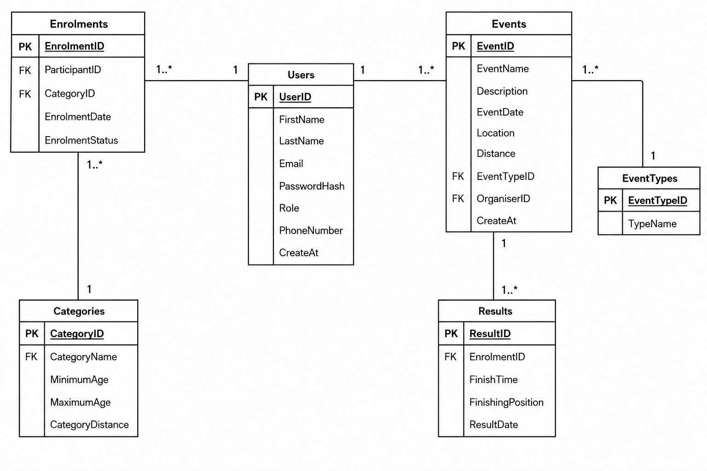

# RaceDay - Race Event Management System

RaceDay is a web platform for the South African road running, walking and cycling community. **Organisers** create and manage events, categories, enrolments and results. **Participants** browse events, enter them by choosing a category, and track their race history.

This repository is the Portfolio of Evidence (POE) for PROG6212, submitted in three parts:

| Part | Content | Location |
|------|---------|----------|
| Part 1 | ERD, API endpoint plan, SQL script | [`/docs`](docs) |
| Part 2 | RESTful API (ASP.NET Core 8 + EF Core + SQL Server), Swagger, unit tests | [`/Part2/RaceDay/RaceDay.Api`](Part2/RaceDay/RaceDay.Api), [`RaceDay.Tests`](Part2/RaceDay/RaceDay.Tests) |
| **Part 3 (this submission)** | **ASP.NET Core MVC front end, Azure Blob Storage, Docker, CI/CD** | [`/Part2/RaceDay/RaceDay.Web`](Part2/RaceDay/RaceDay.Web) (branch `part3`) |

> The Part 3 MVC project lives in the same solution as the API (`Part2/RaceDay/RaceDay.Web`) so that both share one Docker build context. Part 3 work is on the `part3` branch.

## Video Presentation (Part 3)

**YouTube (unlisted):** <https://youtu.be/ThV2HefHlLo>

Part 2 video: https://youtu.be/Zo-stGnInX8

---

## Quick Start with Docker (one command)

**Requirements:** [Docker Desktop](https://www.docker.com/products/docker-desktop/) and an Azure Storage account (for image uploads).

```bash
# 1. Clone and enter the repository
git clone https://github.com/Dimpho05/RaceDay.git
cd RaceDay
git checkout part3

# 2. Create your .env file (never committed to Git) and fill in the two values
cp .env.example .env        # Windows PowerShell: copy .env.example .env

# 3. Start everything: SQL Server + API + MVC web app
docker compose up --build
```

`.env` needs two values:

| Variable | Meaning |
|----------|---------|
| `SQL_SA_PASSWORD` | Password for the SQL Server container (8+ characters, upper and lower case, a digit) |
| `BLOB_CONNECTION_STRING` | Azure portal > Storage account > Access keys > Connection string |

When the logs settle, open:

| Service | URL |
|---------|-----|
| **RaceDay web app (MVC)** | http://localhost:8080 |
| RaceDay API (Swagger) | http://localhost:8081/swagger |

The API creates the database and seeds the event types (Run, Walk, Cycle) automatically on first start, so no manual migration step is needed. Stop with `Ctrl+C`; remove containers with `docker compose down` (add `-v` to also delete the database volume).

### Running only the MVC container

If the API is already running somewhere, the web image can be started on its own:

```bash
docker build -f Part2/RaceDay/RaceDay.Web/Dockerfile -t raceday-web Part2/RaceDay
docker run --rm -p 8080:8080 -e Api__BaseUrl=http://host.docker.internal:8081/ raceday-web
```

### Docker design

- **Multi-stage Dockerfiles** (SDK image to build, small `aspnet` image to run).
- The `.csproj` is copied and restored **before** the source, so package restore is cached between builds.
- Runs as the **non-root `app` user**; `.dockerignore` keeps `bin/`, `obj/`, `.vs/` and tests out of the build.
- The web container reaches the API through the compose network (`Api__BaseUrl=http://api:8080/`); the API waits for SQL Server's health check before starting.
- The same code and configuration run locally and in Docker; only connection strings are supplied by environment variables.

---

## Run Locally (without Docker)

Prerequisites: [.NET 8 SDK](https://dotnet.microsoft.com/download/dotnet/8.0), SQL Server Express/LocalDB, an Azure Storage connection string (or [Azurite](https://learn.microsoft.com/azure/storage/common/storage-use-azurite)).

```bash
cd Part2/RaceDay/RaceDay.Api
dotnet user-secrets set "BlobStorage:ConnectionString" "<your connection string>"
dotnet run --launch-profile https        # API: https://localhost:7080/swagger

# in a second terminal
cd Part2/RaceDay/RaceDay.Web
dotnet run --launch-profile https        # MVC app (URL printed in the console)
```

The MVC app finds the API through `Api:BaseUrl` in `RaceDay.Web/appsettings.json` (default `https://localhost:7080/`). The database is created automatically on API start-up.

---

## The Two Roles

| Role | Menu and pages |
|------|----------------|
| **Organiser** | Dashboard, Manage Events (create / edit / delete, banner upload), Categories, Enrolments (confirm / cancel), Results entry, Profile |
| **Participant** | Home (upcoming events + filters), Event details (categories, **Enter Event**), My Enrolments, My Results, Profile (with picture upload) |

Each role sees its own navigation menu. Visiting a page for the wrong role shows an **Access Denied** page; visiting any protected page while logged out redirects to **Login**.

## Features

### Authentication and session management
- Register (choose Organiser or Participant) and log in through the MVC app, which calls the API's `/api/auth` endpoints.
- On login the MVC session stores the **user ID, role and first name**, plus the API's session cookie, which is forwarded on every API call.
- A `[RoleAuthorize]` filter protects every controller: anonymous users are redirected to Login, wrong-role users to Access Denied.
- Logout clears both the MVC and API sessions and redirects to the login page. Responses are `no-store`, so the Back button after logout shows nothing private.

### Organiser interface
- **Dashboard:** summary of the Organiser's events, total enrolments per event and upcoming dates.
- **Events:** create, edit and delete events (name, description, date, location, distance, event type) with an optional **banner image upload**.
- **Categories:** add age or distance categories to each event.
- **Enrolments:** every Participant enrolled for an event with their category and status; confirm or cancel enrolments.
- **Results:** capture and publish finish times and finishing positions after the event.

### Participant interface
- **Home:** upcoming events with filters.
- **Event details:** full information, banner image and available categories; **Enter Event** records the enrolment immediately (status *Pending* until the Organiser confirms).
- **My Enrolments:** every event entered with a colour-coded status.
- **My Results:** event, date, category, finish time and position (e.g. *47th out of 312 finishers*).
- **Profile:** view/update personal details and upload a profile picture.

### Azure Blob Storage
- The MVC app **never talks to Azure**. It posts the image as `multipart/form-data` to the API (`POST /api/events/{id}/banner` and `POST /api/profile/picture`).
- The API validates the file (JPG, PNG or WEBP, max 5 MB), uploads it to the `raceday-images` container via `BlobStorageService`, saves the **blob URL** in the database and deletes the replaced image.
- The stored URL is returned to the MVC app and displayed on the event detail page and profile page.

### UI design
- RaceDay brand: deep navy and energetic orange, **Barlow Condensed** headings and **Barlow** body text, built on Bootstrap 5.
- Enrolment statuses are colour coded: **green = Confirmed, amber = Pending**, red/grey for cancelled and other states.
- Invalid input and API failures show friendly messages and a custom error / 404 page; raw errors are never displayed.

### Architecture
- `RaceDay.Web` contains **no database access and no business logic**. It has no EF Core, SQL or Azure references; the CI pipeline checks this on every push.
- `RaceDayApiClient` (behind `IRaceDayApiClient`) is the single class that makes HTTP calls to the API.
- Controllers are thin: they call the API client, map results to view models and return Razor views.

---

## Repository Structure

```
RaceDay/
├── .github/workflows/
│   ├── ci.yml                      # Validate structure, build API + MVC, run tests, build Docker images
│   └── validate-docs.yml           # Part 1 docs check
├── docs/                           # Part 1: ERD, endpoint plan, SQL script
├── docker-compose.yml              # SQL Server + API + MVC
├── .env.example                    # Template for required secrets
└── Part2/RaceDay/
    ├── RaceDay.slnx
    ├── RaceDay.Api/                # Part 2 API (+ Blob Storage, Dockerfile)
    │   ├── Controllers/  DTOs/  Data/  Filters/  Migrations/  Models/  Services/
    ├── RaceDay.Tests/              # xUnit tests
    └── RaceDay.Web/                # Part 3 MVC app (Dockerfile)
        ├── Controllers/            # Account, Home, Dashboard, ManageEvents, ManageCategories,
        │                           # ManageEnrolments, ManageResults, Events, MyEnrolments, MyResults, Profile
        ├── Filters/                # RoleAuthorizeAttribute
        ├── Models/                 # View models and DTOs
        ├── Services/               # RaceDayApiClient, session helpers
        ├── Views/                  # Razor views per controller + Shared layout/nav
        └── wwwroot/                # site.css theme, Bootstrap
```

---

## CI/CD

The workflow [`.github/workflows/ci.yml`](.github/workflows/ci.yml) runs on **every push** and pull request:

1. **Validate repository structure:** checks `/docs`, the API, tests, MVC project, Dockerfiles, `docker-compose.yml`, that the MVC project has no direct DB/Azure references, and that this README contains the Docker run command.
2. **Build API + MVC and run unit tests:** restores, builds both projects in Release mode on .NET 8, and runs the xUnit tests.
3. **Build Docker images:** builds the API and MVC images to prove both Dockerfiles work.

**Successful green build:**


---

## API Overview (Part 2)

All routes are prefixed with `/api`; full interactive documentation is in Swagger. "Any" means any logged-in user.

| Method | Route | Role |
|--------|-------|------|
| POST | `/auth/register`, `/auth/login` | Public |
| POST | `/auth/logout` | Any |
| GET / PUT | `/profile` | Any |
| POST | `/profile/picture` | Any (uploads to Blob Storage) |
| GET | `/events`, `/events/{id}`, `/event-types` | Any |
| POST / PUT / DELETE | `/events`, `/events/{id}` | Organiser (owner) |
| POST | `/events/{id}/banner` | Organiser (owner, uploads to Blob Storage) |
| GET | `/events/{eventId}/categories`, `/categories/{id}` | Any |
| POST / PUT / DELETE | `/events/{eventId}/categories`, `/categories/{id}` | Organiser (owner) |
| POST | `/enrolments` | Participant |
| GET | `/enrolments/my` | Participant |
| DELETE | `/enrolments/{id}` | Participant (owner) |
| GET | `/events/{eventId}/enrolments` | Organiser (owner) |
| PUT | `/enrolments/{id}/status` | Organiser |
| POST / PUT | `/results`, `/results/{id}` | Organiser (owner) |
| GET | `/results/my` | Participant |
| GET | `/events/{eventId}/results` | Owner Organiser / enrolled Participant |

Authentication uses a server-side session (BCrypt-hashed passwords, 30-minute idle timeout, HttpOnly cookie). No session returns **401**; wrong role returns **403**.

## Unit Tests

`Part2/RaceDay/RaceDay.Tests` starts the real API in memory (`WebApplicationFactory`, EF Core InMemory) and covers authentication, events, enrolments, results, uploads (with a fake blob service) and role enforcement.

```bash
cd Part2/RaceDay
dotnet test RaceDay.Tests/RaceDay.Tests.csproj
```

## Database

Built **Code-First** with EF Core migrations to match the Part 1 ERD (six tables: Users, EventTypes, Events, Categories, Enrolments, Results).



## Security Notes

- Secrets (`.env`, user secrets) are **never committed**; `.env.example` shows what is needed.
- Passwords are stored as BCrypt hashes; the MVC app never sees them after login.
- Azure credentials exist only in the API container.

## Author

Dimpho Mouba - ST10492572
